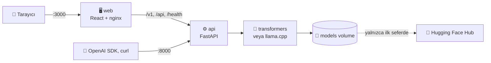

<div align="center">

# ⚓ Liman

**Hugging Face'teki açık kaynaklı bir dil modelini Docker içinde çalıştırıp tarayıcıdan sohbet etmeyi gösteren bir demo.**

[](LICENSE)
[](https://www.docker.com/)
[](https://huggingface.co/models)

</div>

---

## 📖 Projenin amacı

Liman bir **demo projesidir**. Göstermek istediği tek şey şudur:

> Bir büyük dil modeli (LLM), bilgisayara Python, CUDA ya da herhangi bir model kütüphanesi kurmadan, yalnızca Docker ile ayağa kaldırılabilir. Tarayıcıdan sohbet edilebilir ve OpenAI uyumlu bir API üzerinden kullanılabilir.

`docker compose up` komutu iki konteyner başlatır:

- **api:** Modeli Hugging Face'ten indirir ve belleğe yükler. Yanıtları üretir.
- **web:** Sohbet arayüzünü sunar.

Model bir kez indirildikten sonra her şey yerelde çalışır. Yazılan mesajlar bilgisayardan dışarı çıkmaz.

Bu bir ürün değil, kavram kanıtıdır. Tek kişilik yerel kullanım için tasarlandı. Neyi yapıp neyi yapmadığı aşağıdaki **Artılar ve eksikler** bölümünde açıkça yazıyor.

## 🏗️ Nasıl çalışır



| Servis | Görevi | Port |
|--------|--------|------|
| `web` | Sohbet arayüzü. API isteklerini nginx ile `api` servisine aktarır. | `3000` |
| `api` | Model indirme, yükleme, yanıt üretme ve OpenAI uyumlu uç noktalar | `8000` |

İki tür model desteklenir:

- **Transformers modelleri** (`.safetensors`): Hugging Face `transformers` kütüphanesiyle çalışır.
- **GGUF modelleri:** Nicelleştirilmiş (sıkıştırılmış), daha küçük ve hızlı sürümlerdir. `llama.cpp` ile çalışır.

## 📋 Minimum sistem gereksinimleri

| | Minimum | Önerilen |
|---|---|---|
| **İşletim sistemi** | Linux, Windows 10/11 (Docker Desktop + WSL2) ya da macOS | Linux veya Windows + WSL2 |
| **Docker** | Docker 24+ ve Docker Compose v2 | Güncel sürüm |
| **İşlemci** | 64 bit x86 (x86-64), 4 çekirdek | 8+ çekirdek |
| **RAM** | 8 GB (yalnızca GGUF modellerle) | 16 GB |
| **Disk (CPU)** | 8 GB boş alan | 20 GB+ |
| **Disk (GPU)** | 35 GB boş alan | 50 GB+ |
| **GPU** *(isteğe bağlı)* | NVIDIA, 4 GB VRAM, sürücü 570+ ve [NVIDIA Container Toolkit](https://docs.nvidia.com/datacenter/cloud-native/container-toolkit/install-guide.html) | NVIDIA, 8 GB+ VRAM |
| **İnternet** | İlk kurulum ve model indirme için gerekli | Sonrasında gerekmez |

Bu rakamların nereden geldiği:

- **CPU imajı** yaklaşık **2 GB**'tır. **GPU imajı** CUDA kütüphaneleri nedeniyle diskte yaklaşık **25 GB** yer kaplar.
- **Varsayılan model** (`Qwen2.5-1.5B-Instruct`) diskte yaklaşık **3 GB**'tır. CPU'da 32 bit çalıştığı için belleğe yüklenince yaklaşık **6–7 GB RAM** kullanır. 8 GB RAM'li makinede bunun yerine GGUF sürümünü seçin: yaklaşık 1 GB'tır ve 1–2 GB RAM'le çalışır.
- **Windows'ta** Docker Desktop, WSL2'ye varsayılan olarak RAM'in yalnızca bir kısmını verir. Gerekirse `.wslconfig` dosyasından artırın.
- **macOS'ta** konteynerler Apple GPU'suna erişemez. Modeller CPU'da çalışır.
- **AMD GPU'lar** desteklenmez. Ayrıca ARM işlemciler (Apple Silicon, Raspberry Pi) üzerinde test edilmedi.

**Test edilen ortam:** Windows 11, Docker Desktop, 16 GB RAM, NVIDIA RTX 4060 Laptop (8 GB VRAM).

| Model (GPU, 120 token'lık yanıt) | Süre |
|---|---|
| `Qwen2.5-1.5B-Instruct` (transformers) | ~3.5 sn |
| `Qwen2.5-1.5B-Instruct-GGUF` (q4_k_m) | ~1.1 sn |

## 🚀 Hızlı başlangıç

```bash
git clone https://github.com/kullanici-adi/liman.git
cd liman
cp .env.example .env

# CPU ile
docker compose up -d --build

# veya NVIDIA GPU ile
docker compose -f docker-compose.yml -f docker-compose.gpu.yml up -d --build
```

Ardından tarayıcıda **http://localhost:3000** adresini açın.

İlk çalıştırmada beklenen süreler:

| Adım | CPU | GPU |
|---|---|---|
| İmaj derleme | Birkaç dakika | 15–30 dk |
| Varsayılan modelin indirilmesi (~3 GB) | İnternet hızına bağlı | İnternet hızına bağlı |

Model indirilip yüklenirken üst çubukta durum görünür. İlerlemeyi şu komutla da izleyebilirsiniz:

```bash
docker compose logs -f api
```

### Kullanım

- **Sohbet:** Sol menüden yeni sohbet açın. Geçmiş, tarayıcıda saklanır.
- **Ayarlar (⚙):** Sistem istemini, sıcaklığı ve en fazla yanıt uzunluğunu değiştirin. Her ayarın yanındaki ⓘ işareti ne işe yaradığını açıklar.
- **Model değiştirme:** Üst çubuktaki model adına tıklayın.
  - **İndirilenler** sekmesi diskteki modelleri gösterir. Buradan bir modele geçebilir ya da kullanılmayan bir modeli silebilirsiniz.
  - **Hub'da ara** sekmesinde Hugging Face'te arama yapılır. Bir sonuca tıklayınca GGUF sürümleri boyutlarıyla listelenir ve belleğe sığıp sığmayacağına dair kaba bir tahmin gösterilir.
  - İndirme ilerlemesi canlı görünür ve iptal edilebilir.
  - Yeni model yüklenemezse önceki modele geri dönülür.

> 💡 Varsayılan sistem istemi modelden **İngilizce, kısa ve sade** yanıt ister, çünkü küçük modeller Türkçede zayıftır. Türkçe kullanım için en az 7B bir model önerilir, örneğin `Qwen/Qwen2.5-7B-Instruct-GGUF` q4_k_m (~4.7 GB, 8 GB VRAM'e sığar). Bu durumda sistem istemini ayarlardan değiştirebilirsiniz.

## ⚙️ Yapılandırma

Ayarlar `.env` dosyasından okunur:

| Değişken | Varsayılan | Açıklama |
|----------|-----------|----------|
| `MODEL_ID` | `Qwen/Qwen2.5-1.5B-Instruct` | Açılışta yüklenecek Hugging Face modeli |
| `MODEL_FILE` | *(boş)* | GGUF deposunda kullanılacak dosya. Örnek: `qwen2.5-1.5b-instruct-q4_k_m.gguf`. Boşsa transformers kullanılır. |
| `HF_TOKEN` | *(boş)* | Yalnızca lisans onayı isteyen (gated) modeller için gerekir |
| `DEVICE` | `auto` | `auto`, `cpu` ya da `cuda`. `auto` GPU varsa onu seçer. |
| `MAX_CONTEXT` | `4096` | Bir sohbette modele gönderilebilecek en fazla token |
| `MAX_NEW_TOKENS` | `1024` | API isteklerinde yanıt uzunluğu sınırının varsayılanı |
| `TEMPERATURE` | `0.7` | API isteklerinde sıcaklığın varsayılanı |
| `WEB_PORT` / `API_PORT` | `3000` / `8000` | Bilgisayarda açılan portlar |
| `BIND_ADDRESS` | `127.0.0.1` | Portların açıldığı adres. Varsayılan değerle yalnızca bu bilgisayardan erişilir. `0.0.0.0` ağdaki diğer cihazlara da açar. |
| `CORS_ORIGINS` | *(boş)* | API'yi başka bir adresteki web uygulamasından çağırmak için izin verilen adresler. Liman arayüzü için gerekmez. |

Arayüzden seçilen model kalıcıdır; konteyner yeniden başlasa da korunur. `.env`'de `MODEL_ID` veya `MODEL_FILE` değiştirilirse `.env`'deki değer geçerli olur. `.env` değişikliğinden sonra servisi yeniden oluşturun, çünkü `restart` komutu `.env`'i yeniden okumaz:

```bash
docker compose up -d api
```

## 🔌 API

API, OpenAI ile uyumludur. OpenAI SDK'sı ya da `curl` ile kullanılabilir:

```python
from openai import OpenAI

client = OpenAI(base_url="http://localhost:8000/v1", api_key="gerekmiyor")
yanit = client.chat.completions.create(
    model="local",
    messages=[{"role": "user", "content": "What is Docker? One sentence."}],
)
print(yanit.choices[0].message.content)
```

| Uç nokta | Yöntem | Açıklama |
|----------|--------|----------|
| `/v1/chat/completions` | `POST` | Sohbet yanıtı (`"stream": true` ile akışlı) |
| `/v1/models` | `GET` | Yüklü modeli döndürür |
| `/health` | `GET` | Model durumu, indirme ilerlemesi, RAM/VRAM bilgisi |
| `/api/hub/search?q=` | `GET` | Hugging Face'te model arar |
| `/api/hub/repo?model_id=` | `GET` | Bir modelin indirilebilir sürümlerini listeler |
| `/api/models/local` | `GET` / `DELETE` | İndirilmiş modelleri listeler ya da `?model_id=` ile siler |
| `/api/models/load` | `POST` | `{"model_id": "...", "model_file": "..."}` ile modele geçer. Model diskte yoksa önce indirir. |
| `/api/models/cancel` | `POST` | Süren indirmeyi iptal eder |
| `/docs` | `GET` | Etkileşimli API belgeleri (Swagger) |

## ⚖️ Artılar ve eksikler

### ✅ Artılar

- **Tek komutla kurulum:** Bilgisayara Python, CUDA ya da PyTorch kurulmaz. Silmek için `docker compose down -v` yeterlidir.
- **Gizlilik:** Model indirildikten sonra internet gerekmez. Mesajlar hiçbir sunucuya gitmez.
- **Aynı kod, CPU ve GPU:** Yalnızca derleme argümanları değişir. GPU yoksa sistem otomatik olarak CPU'ya geçer.
- **İki model biçimi:** Transformers modellerini ve GGUF modellerini çalıştırır. GGUF modeller düşük bellekli makinelerde de çalışır.
- **OpenAI uyumlu API:** OpenAI SDK'sı kullanan mevcut kod, yalnızca `base_url` değiştirilerek yerel modele bağlanır.
- **Arayüzden model yönetimi:** Arama, indirme, iptal, silme ve hata olunca önceki modele dönüş arayüzden yapılır.
- **Kalıcı önbellek:** Modeller bir Docker volume'unda durur. Konteyner yeniden oluşturulunca tekrar indirilmez.

### ⚠️ Eksikler ve sınırlamalar

- **Yalnızca yerel kullanım için güvenli:**
  - Portlar varsayılan olarak yalnızca `127.0.0.1`'e açılır, yani ağdaki diğer cihazlar erişemez.
  - CORS kapalıdır, yani tarayıcıda açık başka web siteleri `localhost`'taki API'yi çağıramaz.
  - API'de parola ya da anahtar yoktur. Bu, tek kişilik yerel kullanımda sorun değildir. Ama `BIND_ADDRESS=0.0.0.0` ile ağa açılırsa aynı ağdaki herkes modeli kullanabilir, indirme başlatabilir ya da model silebilir.
- **Tek kullanıcı, tek istek:**
  - Aynı anda yalnızca bir yanıt üretilir; diğer istekler sırada bekler.
  - Aynı anda yalnızca bir model bellekte durur.
- **Küçük modellerin kalitesi düşüktür:**
  - Varsayılan 1.5B model hızlıdır, ama özellikle Türkçede bozuk ve yanlış yanıtlar verir. Örneğin testte İstanbul'u "başkent" olarak anlattı.
  - Model ne kadar büyükse yanıtlar o kadar iyidir, ama daha fazla bellek ve disk gerekir.
- **GPU imajı çok büyük:** Diskte yaklaşık 25 GB yer kaplar ve ilk derleme 15–30 dakika sürer. API kodunda yapılan her değişiklik de birkaç dakikalık yeniden derleme gerektirir.
- **Uzun sohbetler kesilmez:** Sohbet `MAX_CONTEXT` sınırını aşınca eski mesajlar otomatik atılmaz, API hata döndürür. Bu durumda yeni sohbet açılmalıdır.
- **Sohbet geçmişi yalnızca tarayıcıdadır:** Geçmiş `localStorage`'da tutulur. Başka cihazdan görülemez, tarayıcı verisi silinince kaybolur.
- **Bellek tahmini kabadır:** Arayüzdeki "sığar / sığmaz" uyarısı yalnızca dosya boyutuna dayanır. İndirmeden önce boş disk alanı da kontrol edilmez.
- **Arama sonuçları ham gelir:**
  - Lisans onayı isteyen modeller (Llama, Gemma vb.) gizlenir; bunlar yalnızca `.env` ve `HF_TOKEN` ile kullanılabilir.
  - Sonuçlarda `tiny-random-...` gibi deneme depoları da çıkar.
  - AWQ/GPTQ gibi özel biçimdeki modeller listelenir ama büyük ihtimalle yüklenemez. Bu durumda önceki modele dönülür.
- **Sınırlı donanım:** Yalnızca NVIDIA GPU desteklenir. AMD (ROCm) ve Apple GPU (Metal) desteklenmez.
- **Otomatik test ve CI yok:** Özellikler elle test edildi. Bağımlılık sürümleri yalnızca alt sınırla belirtildi, sabitlenmedi.

## 🧭 Demodan ürüne: geriye kalanlar

Projenin demo olmaktan çıkıp gerçekten kullanılabilmesi için yapılması gerekenler, öncelik sırasıyla:

1. **Ağ üzerinden kullanım için güvenlik:** Yerel kullanımda gerekmez. Başka cihazlardan erişilecekse:
   - API anahtarı ya da parola koruması ekleyin.
   - HTTPS kullanın.
   - Model indirme ve silme işlemlerini yetkili kullanıcılarla sınırlayın.
2. **Testler ve CI**
   - API için otomatik testler yazın (pytest).
   - Her değişiklikte imajları derleyen bir GitHub Actions iş akışı kurun.
3. **Hazır imajlar:** CPU ve GPU imajlarını GitHub Container Registry'ye yükleyin. Böylece kullanıcı 30 dakikalık derleme yerine yalnızca `docker pull` yapar.
4. **Sabitlenmiş bağımlılıklar:** `requirements.txt` ve `package-lock.json` sürümlerini sabitleyin. Böylece derleme her zaman aynı sonucu verir.
5. **Uzun sohbet yönetimi:** Bağlam dolunca eski mesajları otomatik kırpın ya da özetleyin.
6. **İndirme öncesi kontroller:** Boş disk alanını kontrol edin. Desteklenmeyen biçimleri (AWQ/GPTQ) ve deneme depolarını arama sonuçlarından eleyin.
7. **Çok kullanıcılı çalışma:** Aynı anda birden fazla isteği verimli işlemek için vLLM gibi bir sunucu kullanın.
8. **Belgeler:** README'ye ekran görüntüsü ya da kısa bir GIF ekleyin. Depo adresindeki `kullanici-adi` kısmını gerçek GitHub kullanıcı adıyla değiştirin.

## 📁 Proje yapısı

```
liman/
├── api/                      # Backend (FastAPI, Python 3.12)
│   ├── app/
│   │   ├── main.py           # Uygulama giriş noktası
│   │   ├── config.py         # .env ayarları
│   │   ├── hub.py            # Hugging Face araması, indirme, yerel önbellek
│   │   ├── engines/          # transformers ve llama.cpp motorları, model yöneticisi
│   │   └── routes/           # /v1, /api ve /health uç noktaları
│   ├── requirements.txt
│   └── Dockerfile            # CPU/GPU, derleme argümanlarıyla seçilir
├── web/                      # Arayüz (React + Vite, nginx ile sunulur)
│   ├── src/
│   ├── nginx.conf
│   └── Dockerfile
├── docker-compose.yml        # CPU yapılandırması
├── docker-compose.gpu.yml    # NVIDIA GPU eklentisi
├── .env.example
├── CONTRIBUTING.md           # Geliştirme ortamı kurulumu
└── LICENSE
```

## 🛠️ Sorun giderme

<details>
<summary><b>GPU kullanılmıyor, durum "CPU" gösteriyor</b></summary>

NVIDIA Container Toolkit'in kurulu olduğunu doğrulayın:

```bash
docker run --rm --gpus all nvidia/cuda:12.8.1-base-ubuntu24.04 nvidia-smi
```

Ayrıca servisin `docker-compose.gpu.yml` ile başlatıldığından emin olun.
</details>

<details>
<summary><b>Konteyner "Killed" ya da bellek hatasıyla kapanıyor</b></summary>

Model, kullanılabilir RAM/VRAM'den büyük. Daha küçük bir model ya da GGUF q4 sürümünü seçin. Windows'ta WSL2'ye ayrılan belleği `.wslconfig` dosyasından artırın.
</details>

<details>
<summary><b>Model indirilirken 401 / 403 hatası</b></summary>

Model lisans onayı istiyor. Hugging Face'te modelin sayfasından lisansı kabul edin, `.env` dosyasına `HF_TOKEN` ekleyin ve modeli `.env` üzerinden seçin.
</details>

<details>
<summary><b>Tüm modelleri ve verileri silmek</b></summary>

```bash
docker compose down -v   # models volume'u dahil her şeyi siler
```
</details>

## 📄 Lisans

Kod [MIT Lisansı](LICENSE) ile lisanslanmıştır. Çalıştırılan modeller kendi lisanslarına tabidir; kullanmadan önce modelin Hugging Face sayfasındaki lisansı kontrol edin.

## 🙏 Teşekkürler

[Hugging Face](https://huggingface.co/) · [llama.cpp](https://github.com/ggml-org/llama.cpp) / [llama-cpp-python](https://github.com/abetlen/llama-cpp-python) · [FastAPI](https://fastapi.tiangolo.com/) · [React](https://react.dev/) · [Docker](https://www.docker.com/)
